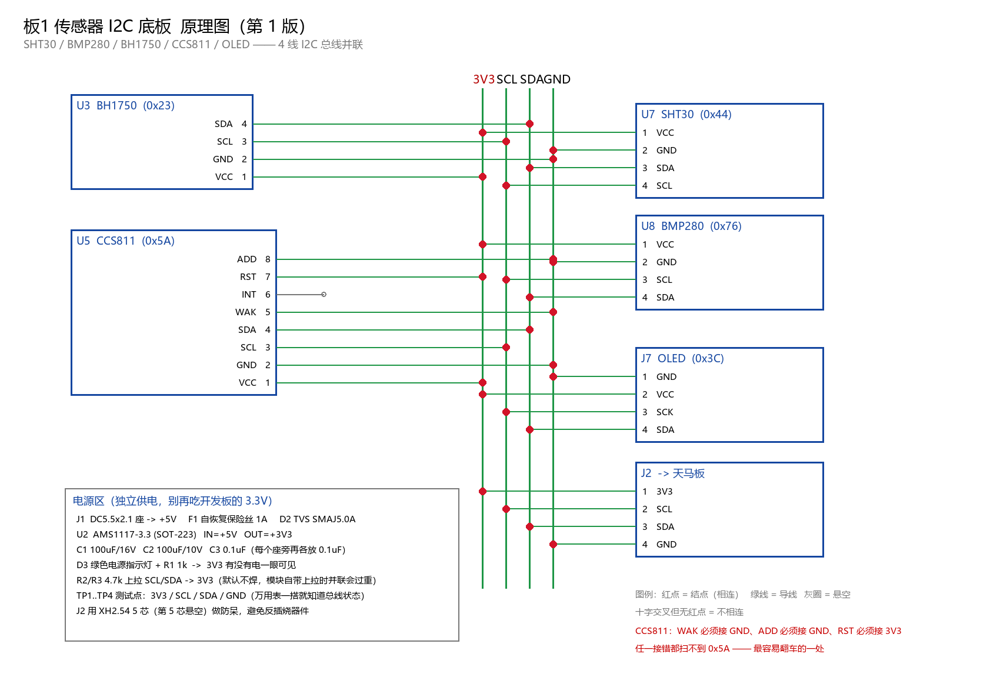

# 板1 传感器 I2C 底板 · 设计说明 v1

> 目的：把 SHT30 / BMP280 / BH1750 / CCS811 / OLED 全部插到一块板上，
> 只留 **4 根线**（3V3 / SCL / SDA / GND）飞到天马 F407 开发板。
> 同时把"供电不足"这个反复出现的问题从根上解决。

---

## 一、为什么会有这块板

这两天踩的坑浓缩成一句话：

| 现象 | 真因 |
|---|---|
| 插上 OLED 板1 就卡在 `[boot]` | 3.3V 被拉垮 |
| 四个传感器集体失灵、`SHT30_FAIL` 每 2 秒 +1 | 从机被拖到 BUSY，只有断电才恢复 |
| ESP-01S 四个波特率全无应答 | 模块根本没通电 / CH_PD 没拉高 |
| 板1+板2 一起跑就各种抽风 | 峰值合计 ≈ 980mA，超过扩展坞单口 500mA |

**结论：不是代码问题，是"所有模块都吃开发板那颗 LDO"的结构问题。**

这块底板做的三件事：

1. **独立供电**——自带 5V 输入 + AMS1117-3.3，不再和 MCU 抢那颗小 LDO
2. **集中走线**——一条 I2C 母线并联，插拔模块不用重新接线
3. **可观测**——电源灯 + 4 个测试点，出问题万用表一搭就知道

---

## 二、原理图



读图约定：

- **红点 = 结点（相连）**
- **十字交叉但无红点 = 不相连**
- **灰圈 = 故意悬空**

---

## 三、关键设计决策（为什么这么接）

### 1. 电源：AMS1117-3.3 而不是直接用开发板的 3.3V

开发板上的 3.3V 是给 MCU 用的，余量很小。底板自己从 5V 降压：

```
5V ──[F1 保险丝 1A]──┬── AMS1117-3.3 ── 3V3
                     │
                    D2 TVS（防浪涌）
```

- 输入 100µF + 输出 100µF + 0.1µF，三颗不能省
- AMS1117 在 5V→3.3V、500mA 时发热 (5−3.3)×0.5 = 0.85W
  → **SOT-223 的散热焊盘要铺铜，至少 10×10mm**

### 2. 上拉电阻默认不焊（R2/R3 标 DNP）

模块大多**自带 4.7k 上拉**。四个模块并联就是 1.2k，虽然还能跑，
但上升沿过陡、功耗也高。所以底板只留焊盘：

- 模块自带 → 不焊
- 模块不带 → 焊 4.7k

**怎么判断**：断电，万用表量模块的 SDA 与 VCC 之间电阻，≈4.7k 就说明带了。

### 3. 每个座旁一颗 0.1µF

```
J3 VCC ──┬── 0.1µF ── GND
         └── 模块 VCC
```

模块插拔瞬间的电流冲击靠它吸收，这是"传感器时不时失灵"的常见解药。

### 4. CCS811 三根线必须接死（最容易翻车）

| 脚 | 名称 | 接法 | 接错的后果 |
|---|---|---|---|
| 5 | nWAKE | **GND** | 不进 I2C 模式，扫不到 0x5A |
| 7 | nRESET | **3V3** | 一直处于复位，读不到 ID |
| 8 | ADDR | **GND** | 地址变 0x5B，驱动扫不到 |

代码里写死的是 `0x5A`，所以 **ADDR 必须接地**。

### 5. J2 用 5 芯而不是 4 芯

多一根空脚做**防呆**。4 芯如果反插，3V3 会直接怼到 GND 上。

### 6. 预留电源监测（建议加，本版未画）

```
3V3 ──[100k]──┬──[33k]── GND
              └── 接 MCU 的 ADC
```

固件里就能打印 `[电源] 3V3 = 3.28V`，
以后"莫名挂掉"就能一眼看出是不是电压跌了。

---

## 四、完整网表 / BOM

- [网表.csv](网表.csv) —— 逐脚连接，画板时照着点
- [BOM.csv](BOM.csv) —— 元件清单，含封装与数量

**总共 25 个元件，两层板，尺寸建议 80 × 60 mm。**

---

## 五、在嘉立创 EDA 里怎么画（约 1.5 小时）

### 步骤 1：建工程

```
嘉立创EDA（专业版）→ 新建工程 → 命名为 "B1_Sensor_Base"
```

### 步骤 2：放元件（在"基础库"里搜）

| 元件 | 搜什么 |
|---|---|
| 排母 1x4 | `排母 2.54 1x4` |
| 排母 1x8 | `排母 2.54 1x8` |
| AMS1117-3.3 | `AMS1117-3.3` |
| 电解电容 | `电解电容 100uF` |
| 陶瓷电容 | `0603 0.1uF` |
| 电阻 | `0603 1k` / `4.7k` |
| LED | `LED 0805 绿` |
| DC 座 | `DC-005` |
| 测试点 | 直接用 `焊盘`（单焊盘元件） |

### 步骤 3：连原理图

按 `网表.csv` 一根一根连。**连完一定要做的事：**

```
设计 → 检查DRC → 看有没有 "网络短接" 报错
```

> ⚠️ 你上一版截图里，ADD/RST/WAK 的红点位置可疑，
> 如果 DRC 报"网络短接"，就是那里。

### 步骤 4：转 PCB

```
设计 → 原理图转PCB → 布局
```

### 步骤 5：布局（关键）

```
┌─────────────────────────────────────┐
│  [DC座] [保险丝] [AMS1117] [电容×2] │  ← 电源都放左上角
│                                     │
│  [J2 5P]  ← 飞线出口，放板边        │
│                                     │
│  ┌── I2C 总线（4 条平行走线）──┐    │
│  │                            │    │
│  [J3]  [J4]  [J5]  [J6]  [J7]      │  ← 模块座排成一排
│   │     │     │     │     │        │
│  [C4]  [C5]  [C6]  [C7]  [C8]      │  ← 去耦电容紧贴座子
│                                     │
│  ○TP1 ○TP2 ○TP3 ○TP4               │  ← 测试点放板边
└─────────────────────────────────────┘
```

四条铁律：

1. **J2 靠板边**——飞线不绕远
2. **每个去耦电容紧贴对应的座**（< 5mm）
3. **AMS1117 散热焊盘铺铜**，至少 10×10mm
4. **I2C 走线短、并排、少过孔**

### 步骤 6：布线

```
线宽：电源 0.6~0.8mm   I2C 0.25mm   其他 0.25mm
```

- 顶层走信号，底层铺 GND
- 每个座的 GND 就近打过孔到底层
- I2C 两条线尽量等长、并排

### 步骤 7：出图打样

```
生产 → 生成Gerber → 上传嘉立创 → 2层 1.6mm 沉金 5片
```

预计 **¥30~60，5~7 天**。

---

## 六、打样前检查清单

打印出来，一项一项打勾：

- [ ] DRC 无报错（尤其"网络短接"）
- [ ] CCS811 的 WAK→GND、RST→3V3、ADD→GND 三根确认
- [ ] J2 是 5 芯，第 5 脚悬空
- [ ] 每个模块座旁有 0.1µF
- [ ] AMS1117 散热焊盘铺了铜
- [ ] 电源灯 + 1k 有限流
- [ ] TP1~TP4 四个测试点在板边
- [ ] 丝印标了每个座子的**型号和地址**（0x44 / 0x76 / 0x23 / 0x5A / 0x3C）
- [ ] 丝印标了 J2 的 `1=3V3 2=SCL 3=SDA 4=GND 5=NC`
- [ ] 板子上印了版本号和日期

---

## 七、焊好回来怎么验证（按顺序，别跳）

### 第 1 步：不插模块，只上电

```
量 TP1 对 TP4 → 应该 3.28~3.32V
电源灯亮
```

不亮 → 查 AMS1117 焊接，别往下走。

### 第 2 步：插 SHT30，量总线

```
量 TP2(SCL) 对 TP4 → 3.3V（上拉作用下空闲为高）
量 TP3(SDA) 对 TP4 → 3.3V
```

不是 3.3V → 上拉没焊或者线短路。

### 第 3 步：接天马板，跑 I2C 扫描

板1 上电看串口：

```
[I2C] scan 5 dev: 0x23 0x3C 0x44 0x5A 0x76
```

五个全出来 = 硬件全通。

### 第 4 步：逐个验证

| 器件 | 期望 |
|---|---|
| SHT30 | `SHT30 init=0 proto=2`，温湿度有数 |
| BMP280 | `ID=0x58`，气压 980 左右 |
| BH1750 | 光照 50~100lx（室内） |
| CCS811 | `init=0`，TVOC 需要老化 24~48h 才有意义 |
| OLED | 显示正常，三页可切 |

---

## 八、下一步（如果你要，我可以继续做）

1. **电源监测 ADC** 的完整电路 + 固件读取代码
2. **I2C 自愈**：检测到 NACK 自动 9 时钟恢复 + 总线重初始化（不卡死）
3. **板2 网关底板**（LCD + LoRa + ESP + Flash 一起）
4. 把这份设计**改写成嘉立创 EDA 工程**——需要你在软件里点，我给逐步指令

---

## 九、铺铜规范（双层板）

### 结论先给

**可以两层都铺，但有三个硬前提：**

### 前提 1：两层都必须是 GND，不能一层 GND 一层电源

```
❌ 顶层铺 3V3，底层铺 GND   → 两层铜构成一个大电容，且 3V3 铜皮是天线
✅ 顶层铺 GND，底层铺 GND   → 正确
```

3V3 只在走线里走，不走铺铜。

### 前提 2：顶层铜必须打缝合孔连到底层，否则是"浮空铜"

顶层的 GND 铜如果没有任何过孔连到底层，它就是一块**孤立的金属**——
不接地、不屏蔽，反而会拾取噪声，比自己画还糟。

**缝合孔（Stitching Via）规范：**

| 参数 | 建议值 |
|---|---|
| 孔径 | 0.3mm |
| 焊盘 | 0.6mm |
| 间距 | 板边一圈 5~8mm 一个 |
| 位置 | 每个模块座周围 2~3 个、I2C 走线两侧 |

### 前提 3：必须处理"孤岛铜"

你这块板有 **5 个 2.54 排母（插件）**，它们的焊盘避让区会把铜皮切得很碎。
专业版里这样做：

```
选中铺铜 → 属性栏 → 勾选「移除孤岛」
或：设计 → 铺铜管理器 → 逐个检查
```

### 专业版操作路径

```
1. 放置 → 铺铜区域（或快捷键 P + G）
2. 画一个覆盖整板的矩形（比板框内缩 0.3~0.5mm）
3. 属性栏：网络 = GND，层 = 顶层 / 底层
4. 填充样式 = 实心，线宽 = 0.254mm，间距 = 0.254mm
5. 板边框距 = 0.3mm
6. 两层各画一个，然后「覆铜」
7. 加缝合孔：放置 → 过孔 → 网络 GND，沿板边摆一圈
8. 重新「覆铜」，再跑一次 DRC
```

### 检查清单

- [ ] 顶层铺铜网络 = GND（不是 3V3、不是悬空）
- [ ] 底层铺铜网络 = GND
- [ ] 缝合孔至少 20 个，板边一圈
- [ ] 勾了「移除孤岛」
- [ ] 铺铜到板边 ≥ 0.3mm
- [ ] 覆铜后 DRC 0 错误
- [ ] TP1~TP4 测试点没有被铜皮盖住（专业版会自动避让，但要确认）
